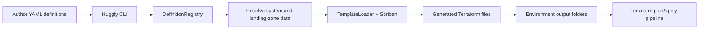
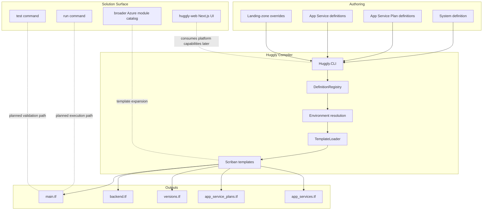
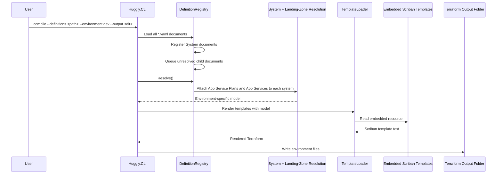
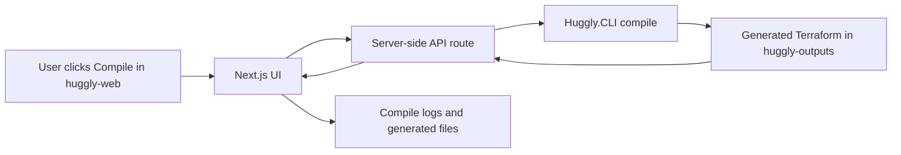
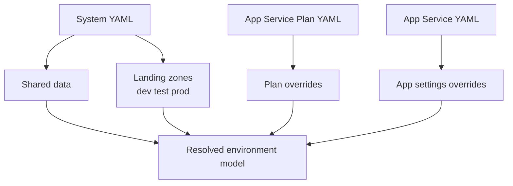

# Huggly

<p align="center">
  
</p>

Huggly is an Azure-first infrastructure generation platform built around a .NET CLI. It turns YAML system definitions into environment-specific Terraform, with embedded Scriban templates acting as the rendering engine.

At its core, Huggly helps you describe a system once, layer in landing-zone overrides for `dev`, `test`, and `prod`, and compile that into predictable Infrastructure as Code outputs. The solution already includes a working compile pipeline for resource groups, App Service Plans, and App Services, and it is clearly being expanded toward a much broader Azure platform catalog.

## Why Huggly Exists

Huggly is designed to separate:

- platform intent in YAML
- environment overrides in landing zones
- rendering logic in reusable templates
- generated Terraform outputs in environment folders

That gives you a clean authoring model for platform teams and a repeatable output model for delivery teams.

## Solution At A Glance



## Architecture



## How The Compile Flow Works

Today, the implemented golden path is the `compile` command.



## Projects In This Repository

- `src/Huggly.CLI`: the command-line entrypoint built on `System.CommandLine`, dependency injection, configuration, and logging.
- `src/Huggly.Core`: domain models, YAML loading, environment resolution, and embedded template rendering.
- `src/huggly-templates`: example authoring input for systems such as `Conferenti`.
- `huggly-outputs`: generated Terraform output examples by environment.
- `src/huggly-web`: an early Next.js web surface that can evolve into a visual authoring or orchestration experience.
- `Dockerfiles`: container assets, including a Dockerfile intended for the web frontend.

## How `huggly-web` Fits With `Huggly.CLI`

`huggly-web` is a strong fit as the visual experience on top of the CLI compiler. The CLI remains the infrastructure engine, while the web app becomes the place where users author definitions, trigger compilation, inspect generated Terraform, and later review validation or deployment results.

The clean architecture is:



That pattern keeps the browser thin and safe:

- the browser never executes the CLI directly
- the API validates inputs such as environment and definition paths
- the server runs `Huggly.CLI compile`
- stdout, stderr, and exit codes can be returned to the UI
- generated Terraform can be browsed or downloaded from the web app

In practice, `huggly-web` could become a Huggly control plane with:

- a system designer for YAML-backed infrastructure definitions
- an environment selector for `dev`, `test`, and `prod`
- a compile button that calls a small API endpoint
- a generated files browser and compile log viewer
- future validation and deployment flows once `test` and `run` are implemented

## Current Domain Model

Huggly currently compiles around a small but useful domain:

- `System`: top-level platform/system definition with shared data and landing zones.
- `AppServicePlan`: Azure App Service Plan definition with environment-specific overrides.
- `AppService`: Azure Web App definition with app settings and site configuration overrides.

The system-level `data` block acts as the shared template model, while landing zones override or extend that base per environment.

## Definition Model

This is the mental model of the YAML contract:



## Output Shape

For each system and environment, Huggly writes Terraform into a dedicated folder:

```text
huggly-outputs/
  dev/
    Conferenti/
      main.tf
      backend.tf
      versions.tf
      app_service_plans.tf
      app_services.tf
```

That structure makes generated outputs easy to inspect, diff, validate, and hand off to a Terraform execution pipeline.

## What Is Implemented Today

- YAML discovery across a definitions directory
- multi-document YAML loading
- system registration plus deferred child-definition attachment
- environment resolution through landing-zone overlays
- embedded Scriban template rendering
- per-environment Terraform generation for system, common, and compute outputs
- working sample outputs for the `Conferenti` system

## What Is Clearly In Progress

- `run` command currently exists as a placeholder for deployment execution
- `test` command currently exists as a placeholder for validation workflows
- the template catalog is expanding well beyond App Services into networking, containers, messaging, monitoring, data, AI, and Kubernetes
- `huggly-web` is still a starter Next.js app rather than a production Huggly control plane

## End-To-End Example

1. Author YAML under `src/huggly-templates`.
2. Run the CLI compile command.
3. Huggly loads all documents and builds a system graph.
4. Huggly resolves environment-specific values.
5. Scriban templates render Terraform files.
6. Generated files are written into `huggly-outputs/<environment>/<system>`.
7. Terraform can then be validated, planned, and applied by your delivery pipeline.

## Running Huggly

For tool installation, the local Kubernetes cluster, and troubleshooting, see the [setup guide](docs/README.md).

Build the solution:

```bash
dotnet build Huggly.CLI.slnx
```

Compile the sample system:

```bash
dotnet run --project src/Huggly.CLI -- compile ^
  --definitions src/huggly-templates/Systems/Conferenti ^
  --environment dev ^
  --output huggly-outputs
```

If you are running from PowerShell on Windows, you can also put the command on one line:

```powershell
dotnet run --project src/Huggly.CLI -- compile --definitions src/huggly-templates/Systems/Conferenti --environment dev --output huggly-outputs
```

## Open Source License

Huggly is available under the MIT License. See [LICENSE](/d:/Hobby/huggly/LICENSE) for the full text.

## Why The Architecture Works Well

- definitions stay human-readable and source-controlled
- the compiler keeps rendering logic out of the YAML
- environment-specific drift is handled through explicit overlays
- generated Terraform stays deterministic and easy to review
- the design leaves room for a future UI and automated execution pipeline without changing the authoring model

## Huggly In One Sentence

Huggly is a YAML-driven infrastructure compiler for Azure platforms that turns system definitions and landing-zone overrides into environment-ready Terraform.
